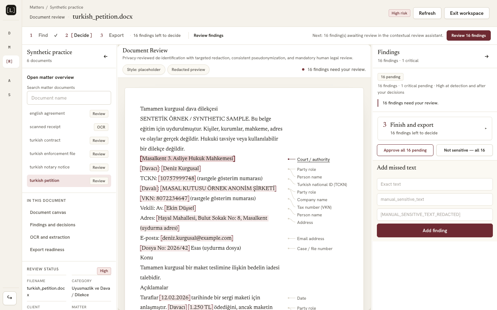
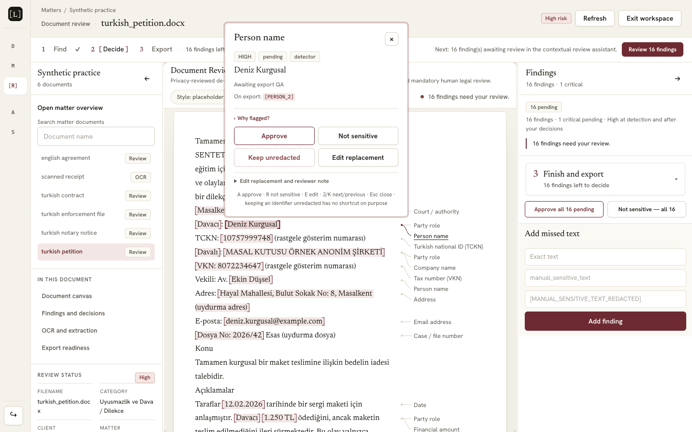
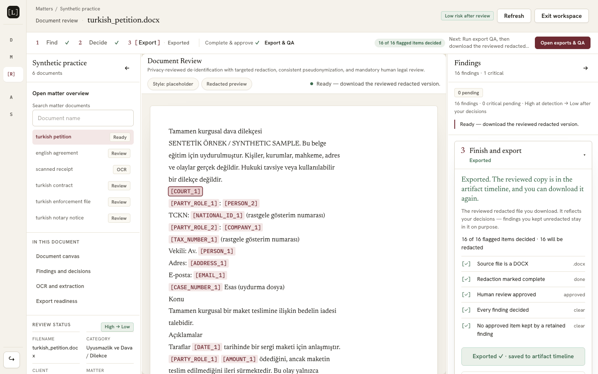
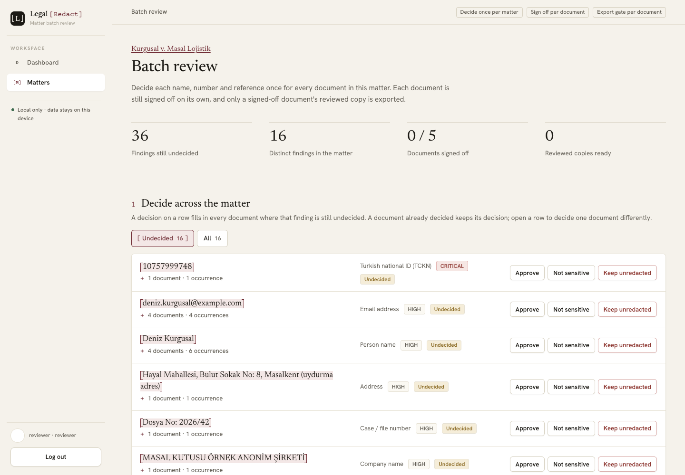
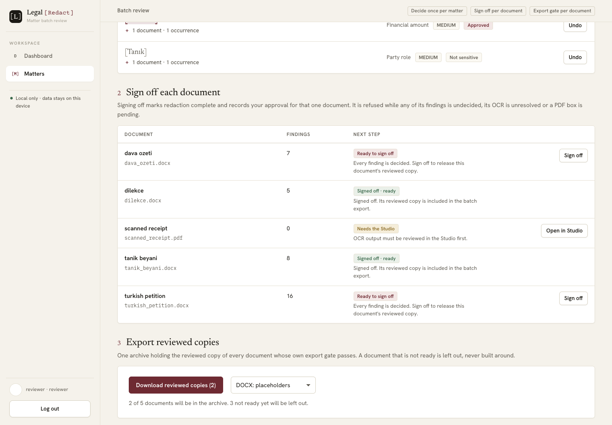

# Legal Redact

**A local legal privacy document workstation.** Organize documents into matters,
inspect privacy findings beside the document, review what should be removed, and
prepare reviewed DOCX or PDF redactions with export checks.

Built for technically comfortable lawyers, legal-tech builders, developers and
founders evaluating a local review workflow, especially for Turkish legal documents.
You run it on your own computer. There is no hosted demo or document upload service.

> **Status: v1.0, a prototype published as source.**
>
> - **Every accuracy figure in this repository is measured on synthetic documents.**
>   No measurement on real legal documents exists yet, so nothing here tells you how
>   the detector performs on your caseload. Read every document yourself.
> - **OCR and scanned-PDF support is experimental and untested.** The local OCR path
>   (Tesseract and Poppler) has not been exercised end to end on real scans; the
>   automated tests feed it prepared OCR output and never run Tesseract itself.
> - **The only way to run it is from this source repository** — clone it and run
>   `./start.sh` (Docker), or follow "Run without Docker" below. There is no prebuilt
>   desktop app, no published Docker image, no hosted service and no Word add-in.



*The real review workspace, on a bundled synthetic document. Findings await a
reviewer's decision; detecting them has not yet redacted the document.*

<p>
  
  
</p>

*Left: one finding decided on its own card. Right: after every finding is decided,
redaction marked complete and the review approved, the reviewed DOCX is exported.*

## Try it locally

Install and start [Docker Desktop](https://docs.docker.com/get-started/get-docker/)
(or a local Docker Engine with Compose). After cloning this repository and
entering its directory, run one command in a shell (Git Bash or WSL on Windows):

```bash
./start.sh
```

It builds the app with **Tesseract, Turkish/English OCR data and Poppler**, initializes
and migrates SQLite, indexes six fictional practice documents, and starts the
workstation. It generates a unique session key and admin password for this install,
then **prints the login URL, username and password** when the app is ready.
Open **http://127.0.0.1:5055/login** and try **Synthetic practice**.

The first build downloads dependencies, so allow a few minutes depending on your
connection; repeat starts reuse the image cache. No Python setup or manually generated
key is needed. [Meet the six samples](samples/README.md), including a scanned PDF
with no text layer for the local OCR workflow (experimental, see "OCR Review" below).

Run `./start.sh` again to resume: it keeps your documents, review decisions and login.
If port 5055 is occupied, use `REDACT_PORT=5056 ./start.sh` and keep that setting for
later starts. Docker publishes the port only on `127.0.0.1`.

## Know the limits before using real documents

- **Rules-based and Turkish-tuned.** There is no ML model or LLM inference.
  **English name and address coverage is materially lower than Turkish coverage** — measured,
  on a held-out synthetic corpus, the detector finds 98% of Turkish personal data and 96% of
  English, but covers only 93% of English entities end to end (Turkish: 98%); it finds 88% of
  English person names (Turkish: 97%). Those name figures rest on given-name lists and on the same person being
  named in full elsewhere in the document, so a real caseload with rarer names will score
  lower. Per-category figures in
  [docs/accuracy.md](docs/accuracy.md). Read every document and add missed findings; few
  findings do not mean low risk, and on an English document they mean very little.

  <!-- The sentence above is pinned verbatim to the studio's on-screen coverage notice by
       tests/test_trust_surfaces.py: the screen must not water down what this file says.
       Reword it here and that test tells you which surface you left behind. -->

  Because of that gap the app declines to clear a document it cannot read: the
  language is detected from the extracted text, and on anything that is not
  Turkish — including a document whose language cannot be identified at all —
  residual risk is reported as `Unknown` and the external-LLM gate refuses. It
  says so rather than showing a green light over a document full of personal
  data. Turkish documents are affected too, and it is worth knowing how: one
  carrying enough ordinary Turkish wording outside the names themselves is
  measured by the Turkish rules exactly as before, which is the common case, but
  a short or name-heavy Turkish document is refused as well — including some of
  the documents in the bundled gold set. A refusal means the document comes to
  you for review instead of being cleared for external use; it does not mean the
  document is unsupported or that anything is wrong with it. The two bullets
  below give the measured cost.
- **A mostly-Turkish document is judged on its English *prose*, and an English
  form is not prose.** A Turkish filing that carries an English *prose* section —
  a witness statement, an English schedule — is treated as unreadable and
  refused. The same personal data set out as labelled fields is not. Measured: a
  Turkish document followed by `Name: …` / `Address line: …` / `Mobile: …` /
  `National insurance number: …` / `Diagnosis: …` reads as Turkish. The English
  rules find the names, the address and the mobile, so it is held for review —
  but the national insurance number and the diagnosis are in no finding, and once
  those findings are approved the gate reads "Allowed for external LLM use after
  completed redaction and approval" with both still in the document. The signal
  counts runs of consecutive English function words; English prose trips it,
  `Name:` and `Mobile:` do not. Read any document with an English attachment
  yourself — the gate cannot stand in for that here.
- **The language gate is conservative, and it is not complete.** The language
  is judged on Turkish *words* that fall outside any name the detector found,
  because a Turkish person, place or company name contains Turkish words by
  definition — counting them as language let a wholly English form clear the
  gate three separate times. Two consequences, both worth knowing before you
  rely on it:
  - **Ordinary Turkish documents are refused.** A document whose Turkish is
    mostly names — a party roster, a signature page, a power of attorney, a
    short filing — has too little left to identify, so it is reported as
    `Unknown` and goes to you instead of being cleared automatically. Five of
    the twenty documents in the bundled synthetic gold set are refused this
    way, even though the Turkish rules read them perfectly (one produces eleven
    findings and is still refused). Nothing leaks; the cost is that you review
    it yourself.
  - **A clear result is not a guarantee.** Three ways an English document could
    pass as Turkish were found one at a time, by looking. Others of the same
    kind — a court name, an institution, a statute title — have not been
    measured, so the absence of a known route is not evidence there is none.
  Closing this properly needs English detection to feed the language decision,
  not another narrowing here.
- **On a database indexed before this version, the risk badge can lag the status.**
  Until you run `python3 db/backfill_language_coverage.py` (see "Migrations"
  below), an already-indexed document can show a green `Low` in the risk column
  directly beside a `Blocked` status, in the dashboard table and in the matter
  workspace. The two are not in conflict about anything that matters: the risk
  column is a stored value from the earlier indexing run, while the release gate
  and every export path work out their answer when you ask them and are correct.
  It is a stale cache in one column, not a gate that has been opened. Running the
  backfill resolves it.
- **Detection is not redaction. Redaction is not anonymization.** A human must review
  findings, OCR and export readiness. Context can still identify a person or matter
  after obvious identifiers are removed. No output is a legal opinion or a compliance
  certification.
- **Single-user, local workstation.** There is no multi-user isolation, hosted service,
  or public demo. Keep it on your own machine; do not expose its port to a LAN or the
  internet. Files and the database are unencrypted on local disk.
- **Prototype quality.** Both corpora are synthetic: `gold/` checks that the rules still
  do what they did, `eval/` measures what they can do, and neither is real-world accuracy;
  no real-document measurement exists. OCR is experimental and untested on real scans,
  and can misread text. DOCX/PDF export checks have limits; inspect the actual
  exported file. Legacy `.doc` extraction uses macOS `textutil` and is unavailable in
  the Linux Docker image; convert it locally to DOCX first.

Read the [threat model](#threat-model), [measured accuracy](docs/accuracy.md),
[accuracy audit](#accuracy-audit), [safety gates](#safety-gates) and
[security policy](SECURITY.md) before using real files.

## Stop, resume and keep your work

From the clone directory:

```bash
docker compose stop          # keep this install's data
./start.sh                   # resume and print the same credentials
```

The Compose project keeps the database and `install.json` (admin credentials and
session key) in its `database` volume, and uploads/exports in its `documents` volume.
They survive rebuilds and container removal. Treat both volumes as confidential;
back up both together while the app is stopped. They are separate from a manual
Python install's `db/legal_documents.db` and `data/`. Run commands from the same clone
and keep the Compose project name stable to reuse the same volumes.

**Destructive reset, only when you want to discard this install:**
`./start.sh --reset` removes its database, uploads, exports and credentials, then
starts a fresh practice workspace. `docker compose down --volumes` also destroys
those volumes. Ordinary `./start.sh` never uses either destructive option.

**Uninstall**, from the clone directory: `docker compose down --volumes --rmi local`
removes the container, both volumes (database, credentials, uploads and exports) and
the image this clone built. Then delete the clone. Do this before a later fresh
install into a folder with the same name, or that install resumes this one.

For startup errors, run `docker compose logs workstation` from the clone directory. If Docker cannot connect,
start your local Docker engine first. If credentials are missing or do not match an
existing database, startup refuses to silently replace them: restore the matching
volume backup. Do not copy `.env` or real documents into the image; its build context
uses an allowlist. Dependency downloads need internet during build; the running app
performs document processing locally without an external document service.

## What the engine is

The detection engine is entirely rules-based: deterministic regular expressions, the
official check-digit algorithms for Turkish national ID (TCKN) and tax (VKN) numbers,
and a Turkish name gazetteer. There is no machine-learning model, no LLM inference, and
no outbound network call — the same document produces the same findings on every run,
and every finding cites the rule that produced it, which is what makes a redaction
decision auditable and reproducible for a lawyer who has to defend it later. No model
does the reading, and no step inside the product sends text to one. The point of the
tool is the opposite: it prepares a document so that a human can afterwards make a
deliberate, informed decision about sending it to an external LLM somewhere else.
Rules also mean rule-shaped limits — a pattern the gazetteer and the regular expressions
do not cover is a pattern the engine will miss, which is why every finding is gated on
human review.

### Person names

A bare name is found when its first word is a known given name, or by its position
(a title, a party role, a labelled line, a list or a signature block, the signature line
itself -- `Signed: …`, `Signed by … and …` -- or, in English, an e-mail address written
right after it on the same line whose local part spells it: `Jane Doe <jane.doe@…>`,
`J. Doe, jdoe@…`). The address path drops a run only when every one of its capitalised
words appears in lowercase elsewhere in the document, so a team mailbox the document also
writes as ordinary words (`Records Management <records.management@…>` beside "records
management") is not a person, while `Ottoline Price` beside "the purchase price" still
is. The given-name lists are the hand-written ones in `legal_analyzer/turkish_names.py` and
`legal_analyzer/english_names.py`, widened from official birth- and population-register
statistics by `build_given_names.py` into `legal_analyzer/given_names_en.py` and
`given_names_tr.py`:

| list | source | licence |
|---|---|---|
| English | US Social Security Administration, national baby-name data: every name in the top 1,000 for its sex in any year 1930–2025 | US government work, public domain (CC0 on data.gov) |
| English | Office for National Statistics, baby names in England and Wales 1996–2025: every name in the top 100 for its sex in any year | Open Government Licence v3.0 (Source: Office for National Statistics) |
| Turkish | TÜİK, Adrese Dayalı Nüfus Kayıt Sistemi tables DF_ADNKS_T32 / T33, the most-used given names by birth year | reuse permitted with the source cited (Kaynak: TÜİK) |

A bigger list also matches words that only look like names, so the script subtracts from
what each source adds: ordinary English words (SCOWL, size 50) and ordinary Turkish words
(Zemberek-NLP's lexicon, Apache-2.0) from both lists, Turkish verb stems and participles
(the Turkish list), places (`turkish_places`, GeoNames
cities and countries, CC BY 4.0, and the US states), brands that are also given names
(English), and legal and structural terms. The hand-written lists are kept whole. The
lists grew from 556 to 5,343 English and from 278 to 527 Turkish names. Without the filter,
"Kira Bedeli" (rent amount), "Kuzey Cephesi" (north face) and "Duran Varlıklar" (fixed
assets) read as people in Turkish documents, and "London EC", "Mercedes Benz", "Geneva Convention" and "Montana Ridge" in English
text.

The filter's cost is measured both ways. It takes real names out with the words: Zemberek
lists many Turkish names as common nouns too, so 241 of TÜİK's 630 names go (Alperen, Nevzat,
Yunus as well as Kuzey, Hava, Savaş), the verb-form filter takes ten more that are also a
verb stem or participle (Arin, Deren, Dilan, Duran, Durmuş, Karan, Parla, Sinan, Yaşar,
Yüksel; Dilan, Sinan and Yaşar stay, being on the hand-written list), and the 100,000-person city cut takes Adelaide out of
the English list -- on the held-out corpus that cost English person-name recall 0.947 -> 0.882,
every lost occurrence an "Adelaide". The signature-line and e-mail paths above later found
four of those five by position rather than by list (English person-name recall 0.974 --
no longer a clean held-out figure, because those paths' rule shapes were derived on
2026-11-24 from reading which `eval/` names were missed; 0.882 was the last clean one);
the fifth, named once in plain prose, is still missed. A word that is
also on a hand-written list is not filtered and still misreads: "Barış Görüşmesi" (peace
talks) is a person, the one false positive the official lists add to the gold set.

Once a document names a person in full, every later bare mention of the surname ("Kartal'ın
vekili", "Quillfeather confirmed …") and every prose repeat of the full name becomes a
finding under the same `[PERSON_n]` pseudonym, and carries the full name's offsets as its
`anchor` — the evidence it rests on, since no rule matched the mention itself. It skips a
word that the document uses as an ordinary word at a sentence start, as a given name, as a
province, or as the first word of a longer proper noun ("Kartal Mahallesi", "Fox News").
Everywhere else it leans to recall, since a missed mention ships a real person and an extra
one costs a rejection: a party's surname that is also a capitalised defined term is proposed
as that party ("the Price" beside "Robert Price"), and the reviewer rejects it.
Approving a propagated bare-surname finding also redacts that word in place or street names
such as "Baker Street" or "Kartal ilçesinde", which the reviewer sees on the canvas and can keep.
Roman generational suffixes are not stripped before the surname is taken ("II"/"III" fold to a
dotless "ı" and never match), so for "John Smith III" the bare "Smith" is not propagated.
What remains is in `privacy._propagated_surname_mentions`' docstring.

## Run without Docker

Install Python 3.11+ and the local OCR binaries first:

```bash
# macOS
brew install tesseract tesseract-lang poppler
# Debian / Ubuntu
sudo apt-get install tesseract-ocr tesseract-ocr-tur tesseract-ocr-eng poppler-utils
```

Then, from the clone:

```bash
python3 -m venv .venv
source .venv/bin/activate
pip install -r requirements.txt
export LEGAL_ANALYZER_ADMIN_PASSWORD="$(python3 -c 'import secrets; print(secrets.token_urlsafe(18))')"
echo "Admin password: $LEGAL_ANALYZER_ADMIN_PASSWORD"   # keep it; you sign in with it
export LEGAL_ANALYZER_SECRET_KEY="$(python3 -c 'import secrets; print(secrets.token_hex(32))')"
python3 db/init_db.py        # keeps an existing database; use --reset to wipe (destructive)
python3 db/migrate.py
export LEGAL_ANALYZER_STOCK_DIR="$PWD/samples/documents"
python3 classify.py
python3 app.py
```

Open `http://127.0.0.1:5000/login` and sign in as `admin` with the password printed above (or set your own). The app refuses to start with a placeholder password, or with none while the database has no admin yet. The six samples are in the **Synthetic practice** matter.

On macOS, AirPlay Receiver also listens on port 5000, so type `127.0.0.1`, not
`localhost` (which can reach AirPlay's blank 403 page instead). To use another port,
start the app with `LEGAL_ANALYZER_PORT=5056 python3 app.py`.

The scanner adds files to the index; it does not perform review or approve exports.
For your own local collection, change `LEGAL_ANALYZER_STOCK_DIR` in both the scanner
and the app environment. Keep it set when restarting so indexed paths resolve.

`LEGAL_ANALYZER_SECRET_KEY` signs session cookies and has **no default** — the app
refuses to start without it, because a known signing key lets anyone forge an admin
session. It also refuses a placeholder (such as an unedited `.env.example` line) and
any key shorter than 32 characters. Generate one once and keep it in your environment
or `.env`.

The first local admin is created from `LEGAL_ANALYZER_ADMIN_USERNAME` and `LEGAL_ANALYZER_ADMIN_PASSWORD`; the username defaults to `admin` when only the password is set.
Changing `LEGAL_ANALYZER_ADMIN_PASSWORD` later does not change an admin that already exists: it keeps its current password, and this version has no in-app password change. To set a new password for that admin (for example one created with an old placeholder), run this from the clone directory (it uses `LEGAL_ANALYZER_ADMIN_USERNAME`, default `admin`):

```bash
python3 -c "import getpass, os, sqlite3, sys; from werkzeug.security import generate_password_hash; u = os.environ.get('LEGAL_ANALYZER_ADMIN_USERNAME', 'admin'); c = sqlite3.connect('db/legal_documents.db'); n = c.execute('UPDATE users SET password_hash = ? WHERE username = ?', (generate_password_hash(getpass.getpass('New password: ')), u)).rowcount; c.commit(); sys.exit('No account named ' + u + ' in db/legal_documents.db; nothing changed.') if n == 0 else print(n, 'account updated:', u)"
```

Or start a fresh database with `python3 db/init_db.py --reset`, which deletes every document and review.

The public page at `/welcome` is prebuilt from [`landing/`](landing/README.md) (React + visx); after changing it, rebuild with `cd landing && npm ci && npm run build`. Node is needed only for that, never to run the app.

## Threat Model

Read this before deciding how to run it, and before trusting anything it says
about a document's privacy status.

**What this is.** A local-first, single-user Flask workstation for one person
at a time on one machine. It classifies documents and detects privacy
findings with regular expressions plus check-digit validation (TCKN/VKN) and a
Turkish name gazetteer — not a machine-learning model, not an LLM, and it makes
no outbound network calls. Every finding requires a human reviewer to
approve it, dismiss it as not sensitive, keep it unredacted, or add one before it affects an export; detection is not
redaction, and redaction is not anonymization until a lawyer has assessed
residual re-identification risk (see "Output Positioning" below).

**What it does not defend against.**

- **Single-user, no multi-tenancy.** There is no concept of separating one
  user's documents, matters, or client roster from another's. Everyone who
  logs in shares the same document store.
- **Binds to `127.0.0.1` and trusts anyone who can reach the port.** The app
  assumes the only thing able to open a TCP connection to it is the person
  running it, on their own machine. It does not defend against another
  process, container, or user on the same host, and it has no protection
  suitable for exposing the port on a LAN or the public internet — putting it
  behind a reverse proxy or port-forward does not make it safe to do so.
  **Do not deploy this on a public host or a shared server as-is.**
- **Trusts local disk.** Documents, findings, exported artifacts, and the
  SQLite database are stored as plain files with no encryption at rest.
  Anyone with filesystem access to the machine (another local account, a
  backup, a stolen disk) can read everything the app can read, including
  documents still awaiting redaction review.
- **Session-cookie auth with three roles, not a hardened identity system.**
  Login uses server-side session cookies and three roles (`admin`, `reviewer`,
  `viewer` — see "Migrations and Local Access Control" below). There is no
  SSO, no MFA, and no per-document access control. Failed sign-ins ARE
  throttled (see "Login throttling" below), and state-changing requests
  require a CSRF token, but neither makes this an identity system you should
  expose to a network.
- **It is a prototype, not a certified anonymisation tool.** Recall and
  precision are measured against a small synthetic gold set, not audited
  against a legal or regulatory standard, and the release gate for external
  LLM use is a set of engineering checks, not a compliance certification (see
  "Accuracy Audit" and "Safety Gates" below). A "Low" residual-risk result or
  a "reviewed" export status is an engineering signal, not a legal opinion
  that a document is safe to share.

If you need multi-user isolation, encryption at rest, network-facing
authentication, or a compliance-audited pipeline, this project does not
provide them today. Run it on a single machine, for a single reviewer, behind
whatever OS-level access control that machine already has.

## Local WSGI operation

`python3 app.py` is Flask's development server: one process, no restart supervision, and written for localhost. For longer-lived local operation, use the WSGI entry point (the Docker command already does):

```bash
pip install gunicorn
export LEGAL_ANALYZER_SECRET_KEY="$(python3 -c 'import secrets; print(secrets.token_hex(32))')"
# Keep HTTPS unset for this plain HTTP loopback example.
gunicorn --workers 4 --bind 127.0.0.1:5000 wsgi:application
```

Configuration that matters here, all read from the environment (see `.env.example`):

- `LEGAL_ANALYZER_SECRET_KEY` — signs the session cookie. **There is no hardcoded fallback and no ephemeral one.** Unset, a placeholder, or shorter than 32 characters, the app refuses to start and tells you how to generate a key. A process that will not boot cannot serve a forgeable session.
- `LEGAL_ANALYZER_PORT` — port for `python3 app.py`, default 5000 (always on `127.0.0.1`).
- `LEGAL_ANALYZER_HTTPS=1` — adds the `Secure` flag to the session cookie. Leave unset for plain http on loopback, where a `Secure` cookie is never sent and login fails silently.
- `LEGAL_ANALYZER_MAX_UPLOAD_BYTES` — request body cap, default 100 MB (the ceiling the ZIP extractor already enforces). Over it, the server returns 413.
- `LEGAL_ANALYZER_DEBUG=1` — re-enables the Werkzeug debugger on the dev server. Off by default because that debugger executes arbitrary code from the browser on any traceback.

Session cookies are `HttpOnly` and `SameSite=Strict` in all configurations. CSRF protection is enforced independently rather than relying on the browser default.

### CSRF protection

Every state-changing request (anything but `GET`/`HEAD`/`OPTIONS`/`TRACE`) must carry the session's CSRF token, either as an `X-CSRF-Token` header or a `csrf_token` form field. Pages get the token from a `<meta name="csrf-token">` tag; `static/csrf.js` wraps `fetch` so same-origin writes carry it without each call site opting in. The token rotates when a session logs in.

An API client obtains a token by issuing a `GET` first (for example `GET /login`) and reading it from the session, then sending it as the header on subsequent writes. Requests without a valid token get `403`.

### Login throttling

Failed sign-ins are recorded in `login_attempts` and throttled per `(username, address)` and per address:

- `LEGAL_ANALYZER_LOGIN_MAX_ATTEMPTS` — failures per username+address before lockout, default 5.
- `LEGAL_ANALYZER_LOGIN_MAX_ATTEMPTS_PER_ADDR` — failures per address across all usernames, default 20. This is what stops one address trying a single password against many accounts.
- `LEGAL_ANALYZER_LOGIN_WINDOW_SECONDS` — rolling window, default 900.

While locked out the endpoint returns `429` with a `Retry-After` header, and the correct password does not bypass it. A successful sign-in clears that caller's record. Counting per username *and* address is deliberate: counting by username alone would let anyone lock a known user out of their own account.

Behind a reverse proxy, `remote_addr` is the proxy unless it is configured to pass the client address through — in that case every caller shares one bucket, so size the per-address cap accordingly.

### What this deployment is and is not

This is single-tenant software. **Every authenticated user can see every document** — there is no per-user or per-organisation scoping in the schema — so this remains a single-user local workstation. WSGI or TLS does not add user isolation or make it suitable for a shared server. Do not expose it to a LAN or the public internet.


## Migrations and Local Access Control

Existing databases should be upgraded with:

```bash
python3 db/migrate.py
python3 db/migrate.py --status
```

A database indexed before the document's language became a release-gate condition
also needs a one-off pass, so the dashboard list stops showing documents as ready
that the gate now refuses. It settles only what the language decides — the
coverage answer, the stored release state, and the risk badge on a document the
rules cannot read. Findings, review statuses and approvals are left as the
reviewer left them. Like `benchmark.py` it loads the app, so
`LEGAL_ANALYZER_SECRET_KEY` must be set:

```bash
python3 db/backfill_language_coverage.py --status
python3 db/backfill_language_coverage.py
```

Re-running it is a no-op for every document it could read. It is deliberately
**not** a no-op for documents whose text it could not read — a source file that
has moved, or a path the container cannot see. Those are left unanswered rather
than recorded, so they stay refused and a later run re-attempts them. The run
reports how many that was; repair the paths or mounts and run it again.

The local app uses session login with three roles:

- `admin`: reviewer permissions plus audit-log access.
- `reviewer`: document review, OCR approval/rejection, manual findings, and redacted exports.
- `viewer`: read-only document list/detail access.

Sensitive actions are written to `audit_log` with actor, role, action, document id, result, timestamp, and sanitized metadata. Raw sensitive text, original-to-placeholder mappings, OCR text, passwords, and replacement text are not stored in audit metadata.

## Benchmark

Run the repeatable benchmark suite:

```bash
python3 benchmark.py
```

For a faster smoke benchmark:

```bash
python3 benchmark.py --limit 25 --api-iterations 5
```

The benchmark writes `benchmark_report.json` and covers document discovery, text extraction, classification, privacy analysis, API latency, database totals, and an optional canary-document check (set `LEGAL_ANALYZER_CANARY_PATTERN` to pin one known-sensitive document and assert it stays High-risk, CRITICAL, and blocked for external LLM use; unset it is reported as skipped).

To test local concurrent API behavior:

```bash
python3 benchmark.py --api-iterations 1000 --api-concurrency 50
```

This is still an in-process local benchmark. It does not replace production load testing with network latency, authentication, logging, workers, or a larger database.

## Accuracy Audit

Speed does not prove privacy quality, and there are two different questions here. Running
one tool in place of the other is how an unmeasured claim gets made.

| | asks | corpus | CI |
|---|---|---|---|
| `accuracy_audit.py` + `gold/` | did the detector lose something it could do? | 37 hand-labelled documents: 34 `.txt` fixtures (23 Turkish, 6 English, 5 name documents) and 3 Turkish `.docx` practice samples | **gated**: `false_negative_count` must be 0 |
| `accuracy_eval.py` + `eval/` | what can the detector do? | 40 generated TR/EN documents as `.txt`, `.docx`, `.pdf` | **reported**: `docs/accuracy.md` must match the run |

### The held-out measurement

```bash
python3 eval/generate_corpus.py --check   # the corpus is what its generator says
python3 accuracy_eval.py                  # measure; writes eval_report.json
python3 accuracy_eval.py --write-docs     # refresh docs/accuracy.md
```

**[docs/accuracy.md](docs/accuracy.md) holds the current figures**, regenerated by CI on
every push so a detection change cannot merge without the numbers it moved moving with it.
It is scored on character offsets, per category and per language, and it reports
*full-span* recall beside plain recall — a finding that covers only part of an entity
leaves the rest in the exported file, and plain recall calls that a hit.

Headline at the time of writing, on 492 labelled entities in 40 documents: **Turkish recall
0.984 (full-span 0.981), English recall 0.992 (full-span 0.958)**, precision 0.98 and 0.99.
Person names are 0.971 Turkish and 0.974 English, up from 0.857 and 0.500 before name
propagation, the official given-name lists and the signature-line and e-mail paths (see
"Person names" under "What the engine is"). The English person-name figure is no longer a
clean held-out measurement: the rule shapes behind the 2026-11-24 signature-line and e-mail
paths were derived that day from reading which `eval/` English names were missed, so 0.882,
measured before them, was the last clean one (the caveat in `docs/accuracy.md`). See
`eval/README.md` for why this corpus may never be used to tune a rule, and what it still
does not tell you.

### The regression ratchet

Run the mini-gold accuracy audit with manually labeled documents:

```bash
python3 accuracy_audit.py --labels gold/gold_labels.example.json
```

The bundled synthetic gold set covers 37 labeled documents (365 required labels). Twenty-six are Turkish: criminal investigation, civil petition, commercial contract, court judgment, enforcement file, employment dispute, medical malpractice, a medical report typed without diacritics whose diagnosis follows a `Doc. Dr.` title, OCR-degraded scan text, notary power of attorney, KVKK data-subject request, lease agreement, and corporate resolution, plus three bare-name documents where person names appear WITHOUT a title or party-role prefix (running text, attendee/witness lists, signature blocks) — the hardest case for a rule-based detector — five regression cases (a case-law opinion citing Yargıtay and Danıştay decisions by numbered chamber and `E.`/`K.` case-number initials, a service agreement whose parties are named by role, `Hizmet Veren` and `Hizmet Alan`, an investigation note naming prosecutor's offices, courts and a notary with a genitive case ending and citing investigation numbers as `2024/12345 sayılı soruşturma`, `… soruşturma numaralı` and `… Soruşturma No'lu`, a file note citing investigation dockets that allege nothing beside two clauses that do allege an offence, `… suçunu işlediği iddia edilen`, and a commercial note naming each company mid-clause, behind a party-role word or after ordinary clause words, as in `Sözleşme gereği Davalı taraf olan yıldızlı örnek holding a.ş.`), and the three practice samples in `samples/documents/` (contract, enforcement file, notarial notice), measured as the `.docx` files the app loads. Six are English: a UK witness statement, a letter before claim, an employment tribunal judgment, a US settlement agreement, a Turkish annex carrying English witness details as labelled fields, and a standard contractual clauses execution page whose signature lines name the parties by role (`Data Exporter`, `Data Importer`). Five are name documents under `tests/fixtures/names/`. Four are one English and one Turkish of each kind: a person named in full and then by bare surname or in prose, and people named in plain prose with given names only the official name lists carry, beside the homographs those lists must not read as people ("Kira Bedeli", "Kuzey Cephesi", "Duran Varlıklar", "London EC2R", "Mercedes Benz"), and bare surnames that are still the person after "the" ("The Ravensworth report") or beside a lowercase repeat ("ekin kartal"). The fifth is an English custodian list naming people whose given names no list carries, found only where the document spells the name for you: right before the e-mail address its local part spells, and on the signature line itself (`Signed: …`, `Signed by … and …`), beside two team mailboxes spelled the same way that are not people.

**This set's recall is 1.000 in every category, and that is what it is for.** Its labels and the rules in `legal_analyzer/privacy.py` have been edited in the same commits, so it is a fitted number, not a held-out one: it says the rules still match their own test set. Anything the detector misses in these documents was largely never labelled, so the set cannot produce a false negative — which is exactly what makes `false_negative_count == 0` a usable CI gate, and exactly why it is not an accuracy claim. For that, read [docs/accuracy.md](docs/accuracy.md).

Five of the twenty-six Turkish gold documents (all among the twenty-three Turkish `.txt` fixtures) now report residual risk `Unknown` rather than a measured level, because the language gate refuses them — see "Know the limits before using real documents" above. That is a refusal, so it raises the reported risk rather than lowering it, and `false_low_count` and `risk_shortfall_count` both stay 0.

**The gold-set figures, stated once.** This paragraph is the only place the repository states this set's current numbers; test docstrings and `gold/README.md` point here instead of repeating them, so a detection change has one line to update. Measured once the labelling gaps were closed (2026-11-24; see "Labelling gaps closed" in `gold/README.md`), with one detection change since the company-span and docket-reference rules of 2026-11-04: the English signature-line and e-mail name paths (2026-11-24; see "Names a document spells for you" there), whose regression document adds 11 labels and 12 findings and no false positive: 37 documents, recall 1.000, **precision 0.9583** — 18 false positives among 432 findings against 365 gold labels — with `false_negative_count`, `false_low_count` and `risk_shortfall_count` all 0, and post-OCR precision 0.8889 on the 2 documents carrying `ocr_text`. Before that pass the same rules scored precision 0.8708, 54 false positives among 418 findings against 318 labels: 39 of those were genuine findings nobody had labelled (27 party roles, 7 dates, 2 authorities, a street address, a trade registry number and an allegation), and 3 allegation fragments were hidden as true positives by labels that ran on through a person's name. The 18 left are rule behaviour, listed with their reasons in `gold/README.md`. 3 are the person rule: "Barış Görüşmesi" (see "Person names"), and `Kuzey Yapı Anonim` and `Yıldız LTD` inside two company names, both lying inside a company finding. The company narrowing moves no figure here, because this audit matches a label to a finding by substring in either direction and so cannot see a span that is too wide; `tests/test_company_span.py` asserts it on offsets. 1 is `UYAP No: 2026/9981` reported as an authority. 14 of the 18 are CRITICAL-risk (`criminal_allegation` 6, `health_data` 5, `privileged_or_confidential` 3). The office `Dolandırıcılık Suçları Soruşturma Bürosu` still reports a `criminal_allegation`, because its own name carries an offence word and the docket rule reads the docket word's whole sentence, across wrapped lines unless the docket's own line is a `Label : value` field, before it as well as after; so does the docket note's heading `Soruşturma dosyalarına ilişkin yazışma notu`, which cites no number. That CRITICAL false positives remain is why dismissing a CRITICAL finding must not keep the release gate shut.

Re-run the command above after any detection change and update that paragraph with what it prints. **Recall alone is not the number to trust** either: quote precision beside it whenever recall is quoted, since a detector can reach recall 1.0 trivially by over-flagging. Track recall, precision, false negatives, and especially `false_low_count` and `risk_shortfall_count`.

Gold-label entries may include `ocr_text` to compare pre-OCR extraction with reviewer-accepted OCR text. The audit reports post-OCR metrics when those fields are present, while keeping `false_low_count = 0` as the target.

For Turkish-lawyer validation, include UYAP/UDF files, petitions, criminal complaints, contracts, scanned exhibits, and clean templates. Label TCKN, VKN, MERSIS, bar registration numbers, court/case numbers, investigation numbers, party roles, addresses, and UYAP terms.

Detection validates TCKN and VKN check digits to cut false positives, and recognizes numbered court chambers (for example `4. Asliye Ticaret Mahkemesi`, `Yargıtay 11. Hukuk Dairesi`), notary offices and judgeships (`24. Noterliği`, `3. Sulh Ceza Hakimliği`), bare 16-digit MERSIS numbers, witness/victim party roles, and apartment-style address fragments. A court, authority or bar-registration finding covers the venue's leading place word too (`Ankara 5. Asliye Hukuk Mahkemesi`, `Kadıköy Cumhuriyet Başsavcılığı`, `Şişli Tapu Müdürlüğü`, `İstanbul Barosu Sicil No`), so the city is approved and redacted with the venue rather than shipping beside it — court plus city is a strong re-identifier. Those place words come from a bounded list (`legal_analyzer/turkish_places.py`, whose docstring states the residuals): a real Turkish place the list does not hold stays outside the finding, and the repair is to add it there; in the other direction, many judicial locations are also ordinary surnames, so a bare surname standing immediately before a venue is given back to the person when that person's full name is detected in the same document (it then carries the person's pseudonym and is redacted only where it stands as a capitalised whole word), and is otherwise redacted as part of the venue. Person names are caught from professional titles (`Av.`, `Dr.`, `Sayın`, including OCR-degraded `Av .`) and from party-role context (`Davacı Elif Şahin`, `şüpheli Kemal Arslan`, `kiracı Barış Tunç`), while all-caps company names stay in the company category. Address matching includes leading street names and survives internal numbering dots (`Bağdat Caddesi No: 41`, `45. Sokak No: 8`). Case-number keywords include `Takip No` and `Yevmiye No` (and a notary's journal number cited as `04512 yevmiye numarası`), and a court decision's numbers are read in the citation form too (`2025/417 E., 2025/1290 K.`, `E. 2025/417`), keyed to the same register as `Esas No: 2025/417`; an investigation number is read in the forms that follow a prosecutor's office too (`2024/12345 sayılı soruşturma`, `… soruşturma numaralı`, `… Soruşturma No'lu`), and a court or authority name keeps its finding when a case ending is attached (`Başsavcılığının`, `Noterliğine`), the ending left outside the span; a high court's numbered chamber is one finding with its court (`Yargıtay 3. Hukuk Dairesi`, `Danıştay 10. Daire`). A contract's defined party roles — `Hizmet Veren`, `Hizmet Alan`, `Alıcı`, `Keşideci`, `Data Exporter` — are not reported as people where a document uses them like names, while a surname that is also a role word (`Murat Alan`) still is. Contract, enforcement and notarial paperwork adds trade registry numbers (`Ticaret Sicil No: 48213`), land-registry parcels (`1417 ada, 23 parsel`, `Ada: 1417 Parsel: 23`), unnumbered enforcement offices (`Masalkent İcra Dairesi`) and phone numbers with a bracketed area code (`(0299) 555 12 34`). Keyword patterns spell out both the diacritic and the diacritic-free spelling of the Turkish keywords (for example `[İi]lçesi|ilcesi`, `beşiktaş|besiktas`, `İcra|Icra`). This is not about the dotted capital `İ`: CPython's `re` module carries an internal case-equivalence table that already relates all four i-forms (`i`, `I`, `ı`, `İ`) under `re.IGNORECASE` — measured, not assumed. What case-insensitivity cannot do is relate `ç`, `ğ`, `ö`, `ş` and `ü` to their ASCII counterparts, and Turkish legal text is routinely typed without diacritics, so those spellings are enumerated explicitly.

## Safety Gates

The current safety logic treats extraction gaps as unsafe:

- Extraction `Complete`: automated text pass completed.
- Extraction `Partial` or `Failed`: residual risk becomes `Unknown`.
- Any extraction warning blocks external LLM use until OCR/manual review.
- Document language outside Turkish, or unidentifiable: residual risk becomes `Unknown` and external LLM use is refused. The language is read from the extracted text (`classifier.detect_language`), never from the filename. A Turkish document carrying an English *prose* section is refused the same way; a field-shaped English annex is not — see "Know the limits" above.
- External hosted LLM use is allowed only when extraction is complete, OCR output is accepted or not required, the document's language is covered by the detection rules, residual risk is Low, critical findings are zero, no direct identifiers remain, redaction is completed, and human review is approved. There is no bypass of the approval — an undocumented `auto_mode_enabled` arm that substituted for it was removed (see `db/migrations/006_retire_auto_mode_bypass.sql`).
- Human review approval is the last step: it is refused (409) until every finding is decided, every PDF redaction box is approved or rejected, and redaction is marked complete. Any later change to a finding decision (its status, its replacement text, or a finding added by hand) or to a PDF box (its status or its rectangle) clears it, so it must be given again.
- Documents that fail any external LLM gate condition are blocked or require review.
- Detected findings are not the same thing as successful redaction.

## Review Workflow

The UI includes a Redaction Studio flow:

- Upload DOCX, PDF, UDF, TXT/MD, image, XLSX/PPTX, or ZIP files.
- Optionally assign uploads to a local client/matter workspace; otherwise they go to `Unassigned`.
- Run local extraction and privacy analysis immediately after upload.
- Open the new document directly in a dedicated Redaction Studio workspace.
- Decide each finding from the card that opens under it when you click it in the document (`J`/`K` move between findings); the review column keeps only whole-document batch actions and any finding the document cannot show. Inspect export gates.
- Export a reviewed DOCX or coordinate-reviewed PDF redaction when the source and gates support it.

The UI also supports first-pass review actions:

- Queue OCR for failed or partial extraction.
- Run local OCR where local tools are available, or submit reviewer-supplied OCR text through the API.
- Accept or reject OCR output before it can affect privacy findings.
- Mark redaction complete.
- Approve or reject review.
- Reset review state.
- Export an actual reviewed DOCX redaction artifact for DOCX source files only.

Approval does not override the release gate. A document remains blocked unless every external LLM gate condition is satisfied.

### Deciding a finding

Each finding gets one of four decisions, and two of them are negative in different ways:

- **Approve** — redact it. The text is replaced in the export.
- **Not sensitive** (`dismissed`) — a false positive. The text stays, and release is not blocked.
  How common depends on the document: see the per-category precision in
  [docs/accuracy.md](docs/accuracy.md) rather than a figure typed here.
- **Keep unredacted** (`retained`) — the finding is real and you are deliberately leaving it in.
  The text stays **and release stays blocked**: a retained finding counts against residual risk,
  a retained direct identifier also trips the direct-identifier gate, and export QA reports the
  count instead of an unqualified pass. This decision is written to the audit log.
- **Add finding** (`added_by_reviewer`) — something the detector missed; redacted like an approval.

The distinction matters: `dismissed` says *the detector was wrong*, `retained` says *the detector
was right and I am accepting the risk*. Collapsing them into one "reject" is what allowed a real
identifier to pass the release gate.

### What stays readable

Redaction removes the sensitive span, not the legal proposition around it. Detection finds
spans; `legal_analyzer/legal_semantics.py` classifies them; `legal_analyzer/redaction_policy.py`
recommends a treatment; a person still decides every finding.

- **Legally operative clauses are never findings.** Confidentiality definitions and
  exceptions, obligations, purpose limits, need-to-know access, penalty clauses, durations,
  survival periods, governing law and jurisdiction stay readable; only the identifiers and
  values inside them are replaced — `her bir ihlal için [PENALTY_AMOUNT_1] cezai şart`.
- **Contractual confidentiality is not attorney-client privilege.** `gizli bilgi`,
  `gizlilik yükümlülüğü`, `ticari sır`, `confidential` and `trade secret` no longer raise a
  privilege finding; privilege needs a privilege marker (`müvekkil`, `privileged`,
  `dava stratejisi`, …) or a named lawyer with advice or communication in the same sentence.
- **`cezai şart` / `ceza koşulu` is a contractual penalty**, not a criminal allegation.
- **Placeholders are typed and stable.** A court or authority is pseudonymised under its kind
  (`[COURT_1]`, `[COMMERCIAL_COURT_1]`, `[TAX_AUTHORITY_1]`, `[ENFORCEMENT_OFFICE_1]`,
  `[NOTARY_1]`, `[PROSECUTOR_OFFICE_1]`, …), amounts and dates by their role
  (`[PENALTY_AMOUNT_1]`, `[LIABILITY_CAP_1]`, `[BIRTH_DATE_1]`), and a company's defined short
  name (`bundan sonra "Kestane" olarak anılacaktır`) takes the company's own placeholder.

The profile sets what each finding's recommended action says, not what is decided:

- `LEGAL_ANALYZER_REDACTION_PROFILE` — `LEGAL_CONTRACT_REVIEW` (default: deadlines and party
  roles are recommended for keeping, amounts for replacing with a typed placeholder) or
  `STRICT_PRIVACY` (every reported value is recommended for replacement). An unknown name
  stops the app at startup.
- `LEGAL_ANALYZER_PRESERVE_AMOUNTS=1` — under `LEGAL_CONTRACT_REVIEW`, recommend keeping exact
  amounts instead.

Identifiers are treated the same in every profile. `docs/accuracy.md` scores the export on two
dimensions — privacy protection and legal semantic preservation — and
`tests/test_nda_end_to_end.py` runs the synthetic NDA in `tests/fixtures/nda/` through upload,
review and the reviewed DOCX.

## Matter Workspaces and Timeline

The workstation supports local matter-level privacy operations:

- `GET /api/matters`
- `POST /api/matters`
- `GET /api/matter/<id>`
- `POST /api/document/<id>/matter`
- `GET /api/document/<id>/artifacts`
- `GET /api/matter/<id>/review-matrix`

Matter pages group documents, finding review rows, OCR state, export/QA artifacts, and sanitized audit context without introducing a general legal chatbot. Artifact timeline entries record original uploads, accepted OCR, reviewed finding snapshots, reviewed DOCX exports, and DOCX QA reports. They are traceability records, not anonymization guarantees.

### Batch review

**Batch review** on a matter's page (`/matter/<id>/review`) clears a whole matter in one pass. It
lists every finding in the matter once, grouped by category and text (Turkish case folded, so
`DENİZ KURGUSAL` and `Deniz Kurgusal` are one row), with the documents it appears in.

- **Decide once.** Approve, Not sensitive or Keep unredacted on a row decides that finding in every
  document of the matter where it is still undecided. A finding already decided — in the Studio, or
  by an override here — keeps its decision. Open a row to decide one document differently; Undo
  returns the row to undecided (a finding you added by hand is left alone).
- **Sign off one document at a time.** The batch never marks redaction complete or approves a
  review. Each document has its own Sign off, which calls the same `/api/document/<id>/review`
  endpoint as the Studio and is refused while any of its findings is undecided, its OCR is
  unresolved or a PDF box is pending. Deciding a finding does not decide its PDF boxes; those stay
  in the Studio.
- **A signed-off document is locked.** Once a document's redaction is marked complete or its review
  approved, no row decision, Undo or override here changes its findings: the batch skips it and
  reports how many it left alone, and an override naming it is refused (409). Reopen it in the
  Studio (`/studio/<id>`) to change it.
- **Export what passed.** Download reviewed copies builds one archive through each document's own
  reviewed-export path. A document whose export gate or output scan refuses is left out.

- `GET /api/matter/<id>/batch`
- `POST /api/matter/<id>/batch/decide` — `{"group_key", "action": approve|dismiss|retain|pending, "document_id"?}`
- `GET /api/matter/<id>/redacted-export?style=placeholder|mask`





## OCR Review

**Experimental and untested.** The local Tesseract/Poppler path has not been run end to
end against real scanned documents, and the automated tests use prepared OCR output
rather than running Tesseract. Treat OCR text, and any PDF boxes derived from it, as a
draft to check against the page.

OCR is local-first in this phase. The API stores OCR text separately by page and does not let OCR output affect findings, redaction completion, or external LLM readiness until a reviewer accepts it.

- `POST /api/document/<id>/ocr/queue`
- `POST /api/document/<id>/ocr/run`
- `POST /api/document/<id>/ocr/accept`
- `POST /api/document/<id>/ocr/reject`

`ocr/run` uses reviewer-supplied JSON text when provided, which is useful for tests or manually corrected OCR:

```json
{"text": "OCR text reviewed locally", "confidence": 0.98}
```

Reviewer-supplied pages can also carry word-level coordinate tokens (normalized 0-1 boxes), which enable OCR-derived PDF redaction boxes:

```json
{"pages": [{"page_number": 1, "text": "...", "tokens": [{"text": "Demir", "x0": 0.2, "y0": 0.1, "x1": 0.3, "y1": 0.13}]}]}
```

Without supplied text, the app tries local `tesseract`; PDF OCR also requires local `pdftoppm`. When tesseract TSV output is available, word bounding boxes are captured into `ocr_tokens` and used to map accepted OCR findings to PDF coordinate boxes (`source = ocr`). No hosted OCR service is called by this workflow. On macOS install both with `brew install tesseract tesseract-lang poppler` (tesseract-lang includes Turkish).

Text extraction covers DOCX, PDF, UDF, TXT/MD, PPTX, XLSX (including numeric cells), legacy DOC (via macOS `textutil`), and ZIP containers of those types (nested ZIPs are skipped). DOCX intake reads the body, headers, footers, footnotes, endnotes, comments and the glossary (saved building blocks), then the strings in `word/people.xml` (comment and tracked-change authors), the `customXml` items (bibliography sources, SharePoint/DMS properties) and an Office add-in's `word/webextensions/taskpanes.xml` and `webextension*.xml` (its reference and the settings it writes), so detection covers them; the document's language is measured on the text parts only. Extraction that hits the size cap is marked truncated and degrades extraction status so export gates block. `POST /api/document/<id>/reextract` re-runs extraction and detection for one document; `POST /api/documents/reextract-failed` retries every document without complete extraction (both reset the document to pending review; OCR-accepted documents are protected).

If OCR text is accepted without any coordinate tokens, native PDF redacted export fails closed: it stays blocked until manual coordinate boxes are drawn and approved.

## Reviewed Native Redaction

Actual reviewed native redacted export supports DOCX and coordinate-reviewed PDF:

- `GET /api/document/<id>/redacted-export?format=docx&style=placeholder`
- `GET /api/document/<id>/redacted-export?format=docx&style=mask`
- `GET /api/document/<id>/redacted-export/qa?format=docx&style=placeholder`
- `GET /api/document/<id>/finding-locations` (DOCX only; where each finding sits for navigation in Word: its story — `body`, `header`, `footer`, `footnotes`, `endnotes`, `comments`, or the unnavigable `glossary`/`data` — with the section and `Primary`/`FirstPage`/`EvenPages` type of a header or footer, and its occurrence as `index` of `count` exact matches in that story. A finding in a comment is not `searchable` (comment text cannot be selected, only its anchor): it carries the comment's `w:id` as `comment_id`, and `index`/`count` are within that one comment. A DOCX with a part past the intake's decompression cap places nothing. The placement comes from the export's own anchoring (`anchor_parts`), so it is the occurrence the export redacts as that finding's own; a finding it cannot place has null location fields. Ids, part names and numbers only, never text. Navigation only: the export never depends on it.)
- `GET /api/document/<id>/pdf/regions`
- `POST /api/document/<id>/pdf/regions` (draw or add a box)
- `PATCH /api/document/<id>/pdf/regions/<region_id>` (move/resize/edit; edits reset the box to pending)
- `POST /api/document/<id>/pdf/regions/<region_id>/approve|reject`
- `POST /api/document/<id>/pdf/regions/review-batch` (filters: `page_number`, `source`, `category`, `region_ids`, `only_pending`)
- `POST /api/document/<id>/pdf/regions/generate`
- `GET /api/document/<id>/redacted-export?format=pdf&style=black_box`
- `GET /api/document/<id>/redacted-export/qa?format=pdf`
- `GET /api/document/<id>/pdf/export-artifact/latest` (re-download the last saved reviewed export; gates are re-checked)
- `GET /api/document/<id>/pdf/qa/latest` (sanitized summary of the last QA run)
- UDF, legacy DOC, images, XLSX/PPTX, and ZIP sources remain blocked for native redacted export.
- DOCX package structure is preserved; text is redacted in place in document body, tables, headers, footers, footnotes, endnotes, comments, and the glossary document, including tracked deletions (`w:delText`) and field codes (`w:instrText`). An external relationship target (a hyperlink or `mailto:`) in any `*.rels` part that carries an approved item is replaced with `#redacted`; the relationship itself is kept so the package stays valid.
- Every reviewed DOCX and PDF is scanned for approved items before it is handed out (`legal_analyzer/export_scan.py`), in every part of the file rather than only where the redactor edits. If one still appears, the download and the matter archive refuse it with an audited 409 naming the parts, never the values, and no artifact is saved. The redactor also removes approved items from what the reader never sees on the page: image descriptions, tooltips, bookmark names (and the links and cross-references that point at them), content-control titles and tags, document variables and non-standard document properties in DOCX; outline titles, links and page labels in PDF, where every attachment is dropped. Anything it still misses is refused rather than exported. Both QA reports run the same scan and fail on any leak, and a document is stamped `redacted_verified` only when its QA `overall_status` is `pass`.
- `placeholder` keeps reviewer-approved placeholders such as `[PERSON_1]`; `mask` uses shorter `[REDACTED]` markers to reduce line-flow changes.
- Only findings with `approved` or `added_by_reviewer` status are redacted.
- An approved finding is redacted at the place it was found, under its own placeholder. Every other match of its text (case- and diacritic-folded, widened to the whole word, a capitalised whole word for a bare surname) is redacted too, as the backstop for repeats detection missed — except where that text lies wholly inside a finding you retained, which keeps its text as written. A document where a retained finding would keep an approved item in the file is not exported: the DOCX export refuses, naming the approved item and the retained finding, until one of the two decisions changes (`legal_analyzer/docx_redactor.py`, `resolve_redaction`).
- Suggested PDF boxes cover every match of a finding's text on every page. Where the page search lines up with the extracted text, each box is labelled as where the finding was found or as a repeat of its text elsewhere; every box is still approved or rejected on its own.
- Reviewer-added findings redact every exact match in supported DOCX text parts.
- Restricted pseudonym mappings are stored in the database and are not included in exported DOCX files.
- Reviewed DOCX export rewrites the document properties (`docProps/core.xml`, `app.xml`, `custom.xml`): title, subject, author, last-modified-by, keywords, description, company, manager, template and custom properties are removed, and a `docProps/thumbnail` picture of the unredacted first page is replaced with a blank image (PNG, JPEG, EMF or WMF; any other thumbnail format is emptied). The authors, initials and dates on tracked changes and comments, the `word/people.xml` authors and presence user ids, and the attached-template path (reduced to its file name) are neutralised; `customXml` data islands no content control binds to are emptied, and bound ones are redacted with the approved targets, as are the attribute values (the add-in's settings) of `word/webextensions/` add-in parts. DOCX export QA compares package parts, Word XML text-node/paragraph/table counts, and finding-sample leakage across the text parts, the document properties and the customXml items, and fails while any of that identifying metadata remains. It is not a pixel/page visual render yet.
- PDF review uses browser black-box overlays for lawyer review, but export uses backend true redaction with PyMuPDF. Preview overlays are not treated as final redaction.
- The in-browser PDF viewer uses a vendored PDF.js build served from `static/vendor/pdfjs/`; no CDN or external network access is needed for PDF review.
- The Studio PDF workspace supports click-and-drag box drawing with category selection, select/move/resize of boxes, keyboard shortcuts (`A` approve, `Delete` reject, `Escape` deselect), page navigation, zoom/fit-width, per-page box counters, and bulk approve/reject controls. Numeric coordinate entry remains as an advanced fallback.
- PDF export requires reviewed coordinate boxes, reviewed findings, redaction completion, human review approval, and passing QA checks for extractable approved sensitive text.
- Reviewed redacted PDF exports are also saved under `data/exports/document_<id>/` and recorded in the artifact timeline; artifact metadata never contains raw sensitive text or pseudonym mappings.
- PDF export QA runs against the last saved export artifact when one exists (otherwise a freshly generated redaction) and checks: approved regions applied, approved sensitive text not extractable (including OCR text layers), metadata scrubbed (the Info dictionary and the XMP packet are both cleared on export, and QA fails if either still carries a value), no annotations/comments remaining, and no unreviewed boxes. Remaining annotations are removed during export. QA reports include before/after visual thumbnails when local rendering is available, with a clear skip warning otherwise.
- QA attributes extractable-text leaks to specific region ids, and the Studio offers a one-click "Reject QA-warning boxes" action for them.
- There is no "preview export" download. The rebuilt lower-assurance TXT/DOCX preview (`GET /api/document/<id>/export`) was removed: it produced a
  non-layout-preserving `<name>_redacted.txt` headed `PRIVACY-REVIEWED REDACTED EXPORT` that, before any review decision, contained the unredacted
  source. The post-decision text is shown in the Studio review canvas (`GET /api/document/<id>/redaction-plan`), which resolves through the same code
  as the reviewed export; the only downloads are the gated reviewed DOCX and PDF exports above.

## Default Inputs

Scan locations are environment-specific -- a document root can itself name real
matters -- so nothing is hardcoded. By default the scanner indexes `documents/`
inside the project and no extra files.

Point it elsewhere with environment variables:

```bash
export LEGAL_ANALYZER_STOCK_DIR="/path/to/docs"
export LEGAL_ANALYZER_EXTRA_FILES="/path/to/one.docx:/path/to/two.pdf"
```

Or per-run on the command line:

```bash
python3 classify.py --stock-dir "/path/to/docs" --extra-file "/path/to/file.docx"
```

The client roster used to attribute documents is likewise confidential and is
never committed. Copy `config/clients.example.json` to `config/clients.local.json`
(gitignored) and fill in your own entries, or set `LEGAL_ANALYZER_CLIENTS_FILE`.
With no roster present, documents are indexed without client attribution rather
than the scan failing.

## UDF Support for Turkish Legal Practice

The scanner supports `.udf` files for Turkish UYAP-style legal document review. UDF support is extraction-first in this phase:

- Plain XML/text-like UDF files are parsed locally.
- Package/zip-style UDF files are scanned for XML/text content.
- Extracted UDF text enters the same classification, privacy finding, review, and OCR/manual text workflow.
- Actual layout-preserving redacted export remains DOCX-only until real UDF package rewriting is validated against UYAP-compatible samples.

## Output Positioning

Use these terms in the UI and API:

- Redaction: removing or masking information.
- Pseudonymization: replacing identifiers with consistent placeholders while a mapping may exist.
- De-identification: reducing identifiability without necessarily eliminating all risk.
- Anonymization: irreversible transformation where the data subject is no longer reasonably identifiable.

For external LLM use, send the version without any mapping table and review all high or critical residual risks first.

## Licence and third-party components

This project's own code is released under the [MIT License](LICENSE).

It also uses third-party software under other licences. Most of it is not in this
repository: you install it yourself, through `pip install` or the Docker build.

- **[PyMuPDF](https://pymupdf.readthedocs.io/) is licensed under AGPL-3.0** (with a
  commercial licence offered separately by its publisher). It performs the reviewed PDF
  redaction. Its licence terms are not the MIT terms of this repository.
- The Docker image installs two OCR tools from the Debian package archive:
  **Tesseract** (`tesseract-ocr` with its Turkish and English data, Apache-2.0) and
  **Poppler** (`poppler-utils`, which supplies `pdftoppm`), **licensed under the GNU GPL**.
  A source install uses whatever copies you install yourself.
- The other Python dependencies in `requirements.txt` are each under their own licence.
- Some third-party code is included in this repository: the PDF.js 3.11.174 build in
  `static/vendor/pdfjs/` (Apache-2.0; its licence file and version note are in that
  directory), the fonts in `static/fonts/` (SIL Open Font License, with the
  licence text beside each font), and the libraries bundled into the prebuilt `/welcome`
  page under `static/landing/` (see `landing/package.json`).

Check each component's licence yourself before you redistribute this software or offer it
to others as a service. This note is not legal advice.
